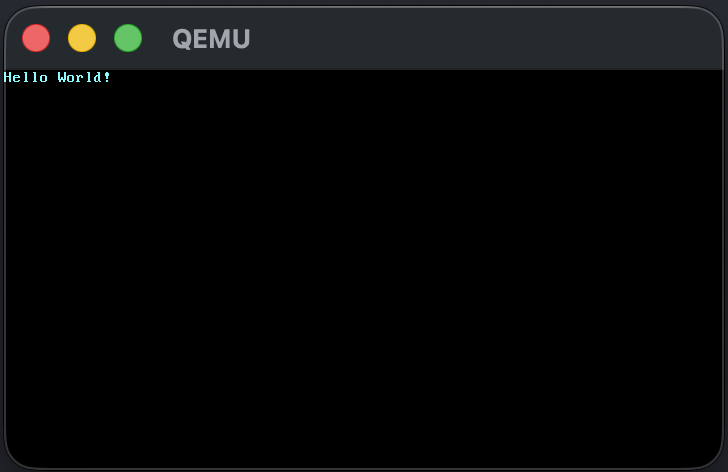

<div align="center">

# 🦀 MakingOS

**Rust로 x86_64 운영체제를 바닥부터 만들어 보는 취미 프로젝트**

[](https://www.rust-lang.org/)
[](blog_os/x86_64-blog_os.json)
[](https://crates.io/crates/bootloader/0.9.35)
[](LICENSE)



*2일차: QEMU에서 커널 부팅 성공*

</div>

---

## 📖 소개

[Writing an OS in Rust (한국어판)](https://os.phil-opp.com/ko/)를 따라가며 OS를 만들고 있습니다.
책이 쓰인 시점과 지금의 Rust 버전이 달라서 생긴 **시행착오와 해결 과정**을 일차별로 기록합니다.

> 🧘 **AI 디톡스 프로젝트**: AI로 한 번에 만들지 않고, 책을 읽고 검색하고 디버깅하면서 직접 만듭니다.
>
> ⏰ 시간 날 때만 하는 취미라 "N일차"는 날짜가 아니라 작업한 횟수입니다.

## 🗺️ 진행 상황

| | 일차 | 책 챕터 | 한 일 | 기록 |
|:-:|:-:|---|---|:-:|
| ✅ | 1 | Freestanding Rust 실행파일 | `no_std`, 패닉 핸들러, `_start` 진입점 | [📝](posts/day01-freestanding-binary.md) |
| ✅ | 2 | 최소 기능을 갖춘 커널 | 커스텀 타겟, `build-std`, VGA에 `Hello World!`, bootimage | [📝](posts/day02-minimal-kernel.md) |
| ⬜ | 3 | VGA 텍스트 모드 | | |

## 🚀 빌드 & 실행

**필요한 것**: Rust nightly, [QEMU](https://www.qemu.org/), bootimage

```bash
# 최초 1회
rustup toolchain install nightly
rustup component add rust-src llvm-tools-preview --toolchain nightly
cargo install bootimage

# 빌드 & 실행
cd blog_os
cargo +nightly build        # 커널 빌드
cargo +nightly bootimage    # 부팅 가능한 디스크 이미지 생성
qemu-system-x86_64 -drive format=raw,file=target/x86_64-blog_os/debug/bootimage-blog_os.bin
```

> 💡 기본 툴체인이 stable이라 `+nightly`를 붙입니다. 툴체인 관련 에러가 나면 [2일차 Tip](posts/day02-minimal-kernel.md#tip-툴체인-때문에-에러가-날-때)을 참고하세요.

## ⚠️ 책과 다른 점 (2026년 nightly 기준)

책대로 하면 빌드가 안 되는 부분입니다. 자세한 과정은 [2일차 기록](posts/day02-minimal-kernel.md)에 있습니다.

| 파일 | 책 | 이 저장소 |
|---|---|---|
| `Cargo.toml` | `edition = "2018"` | `edition = "2024"` |
| `src/main.rs` | `#[no_mangle]` | `#[unsafe(no_mangle)]` |
| `.cargo/config.toml` | | `[unstable] json-target-spec = true` 추가 |
| `x86_64-blog_os.json` | `"target-pointer-width": "64"` | `64` (문자열 → 정수) |
| `x86_64-blog_os.json` | `"target-c-int-width": "32"` | `32` (문자열 → 정수) |
| `x86_64-blog_os.json` | | `"rustc-abi": "softfloat"` 추가 |
| `x86_64-blog_os.json` | `data-layout` 구버전 | LLVM 최신 기본값 |
| `bootloader` | `0.9` | 0.9 계열 최신 (0.9.35). 최신 0.11은 방식이 달라 빌드 실패 |

## 🧰 개발 환경

| 항목 | 버전 |
|---|---|
| OS | macOS (Apple Silicon) |
| rustc / cargo | 1.101.0-nightly (2026-10-29) |
| bootimage | 0.10.5 |
| bootloader | 0.9.35 (`Cargo.toml`에는 `"0.9.23"`) |

## 📁 구조

```
MakingOS/
├── blog_os/
│   ├── .cargo/config.toml     # build-std, 기본 타겟, runner 설정
│   ├── x86_64-blog_os.json    # 커스텀 타겟 명세
│   ├── Cargo.toml
│   └── src/main.rs            # _start 진입점, VGA 버퍼에 Hello World 출력
├── posts/                     # 일차별 기록 (블로그와 같은 내용)
└── images/                    # 기록에 쓴 스크린샷
```

## 🔗 참고

- [Writing an OS in Rust](https://os.phil-opp.com/) ([한국어판](https://os.phil-opp.com/ko/))
- [phil-opp/blog_os](https://github.com/phil-opp/blog_os): 원본 코드

## 📄 License

[MIT](LICENSE)
