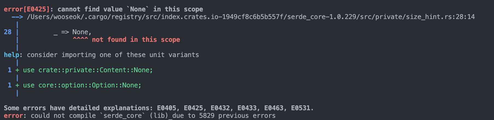
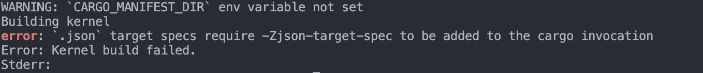
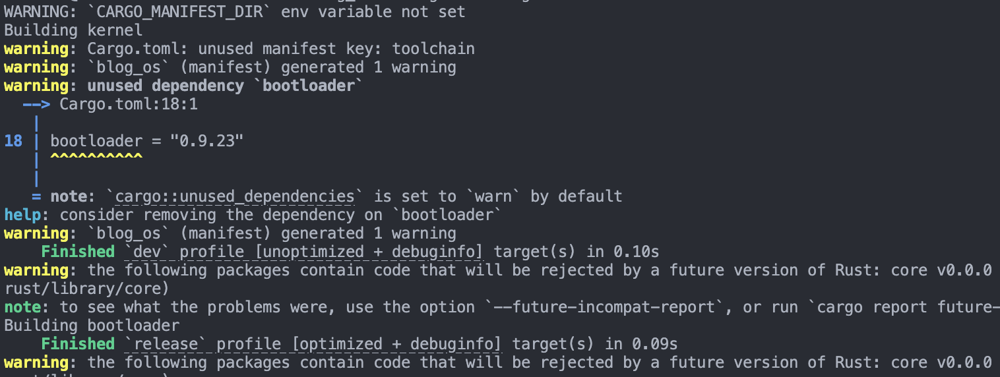
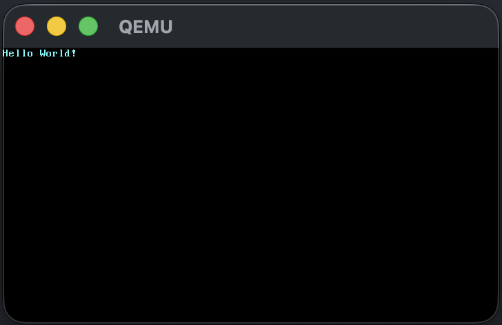

# [Rust로 OS 만들기] 2일차 - 최소 기능을 갖춘 커널 (책대로 했더니 빌드가 안 된다)

## 오늘의 목표

1일차에 만든 freestanding 실행파일을 **실제로 부팅되는 커널**로 만들고, QEMU 화면에 `Hello World!`를 띄우는 게 목표다.

결론부터 말하면 성공은 했다. 그런데 책대로 했더니 빌드조차 안 돼서 시간을 꽤 썼다. 
오늘 글은 그 삽질에 대한 기록과 내가 어떻게 해결했는지 적어 보려고 한다.

## 책대로 진행한 부분

자세한 설명은 [책](https://os.phil-opp.com/ko/minimal-rust-kernel/)에 있으니 한 일만 정리한다.

1. **부팅 과정 이해**: 컴퓨터를 켜면 BIOS가 실행되고, BIOS가 부트로더를 불러오고, 부트로더가 커널을 메모리에 올려 실행한다.
2. **nightly Rust 설치**: 뒤에서 쓰는 `build-std` 같은 기능이 아직 불안정(unstable) 기능이라 nightly가 필요하다.
3. **커스텀 타겟 `x86_64-blog_os.json`**: OS 없는 x86_64용 타겟 명세. 패닉 시 abort, red zone 끄기, SIMD 끄기 등을 정한다.
4. **`.cargo/config.toml`**: `core`를 직접 다시 컴파일하는 `build-std`, `memcpy` 같은 함수를 제공하는 `compiler-builtins-mem`, 기본 타겟을 설정한다.
5. **화면 출력**: VGA 텍스트 버퍼(`0xb8000`)에 글자와 색을 직접 써서 `Hello World!`를 출력한다.
6. **부팅 이미지 만들기**: `bootloader` 크레이트와 `bootimage` 도구로 부팅 가능한 디스크 이미지를 만들고 QEMU로 실행한다.

`src/main.rs`:

```rust
#![no_std]
#![no_main]

use core::panic::PanicInfo;

static HELLO: &[u8] = b"Hello World!";

#[unsafe(no_mangle)]
pub extern "C" fn _start() -> ! {
    let vga_buffer = 0xb8000 as *mut u8;

    for (i, &byte) in HELLO.iter().enumerate() {
        unsafe {
            *vga_buffer.offset(i as isize * 2) = byte;      // 글자
            *vga_buffer.offset(i as isize * 2 + 1) = 0xb;   // 색 (밝은 청록색)
        }
    }

    loop {}
}

#[panic_handler]
fn panic(_info: &PanicInfo) -> ! {
    loop {}
}
```

## 내 환경

- macOS (Apple Silicon)
- 기본 툴체인: `rustc 1.99.1` (stable). 중간에 nightly로 바꿨다가 다시 stable로 되돌렸다.
- 빌드할 때 쓰는 툴체인: `rustc 1.101.0-nightly (2026-10-29)` (`+nightly`로 실행)
- `bootimage 0.10.5`

책이 쓰인 시점보다 Rust가 몇 년치 새 버전이다. 이 차이가 오늘 삽질의 원인이다.

## 문제 1: 빌드 에러가 5000개 넘게 나온다



`serde_core`라는 크레이트를 컴파일하다가 `None`을 못 찾는다는 에러가 수천 개 나왔다. 마지막 줄을 보면 `5829 previous errors`다.

코딩하면서 가장 보기 싫은 것이 에러일 것이다. 그 에러가 내가 사용하는 라이브러리에 관련된 것이라면 진짜 막막하다. 
일단, 에러가 뜨면 먼저 해야 할 일이 있다. 바로 에러를 읽는 것.
제발 에러가 나면 고치려고 하지 말고 왜 어디서 뭐가 틀렸는지 에러 로그를 읽기를 바란다.
에러를 읽었다면 에러코드를 찾아봐야 한다.

### 에러 코드 뜯어보기

스크린샷 마지막에 `Some errors have detailed explanations: E0405, E0425, E0432, E0433, E0463, E0531.`이라고 나온다.
Rust 에러 코드는 `rustc --explain E0425`처럼 치면 설명과 예제를 볼 수 있다. ([온라인 목록](https://doc.rust-lang.org/error_codes/error-index.html)도 있다.)

| 코드 | `rustc --explain` 설명 | 이번에 실제로 나온 메시지 (대표) |
|---|---|---|
| **E0463** | 선언한 크레이트를 찾을 수 없다 | ``can't find crate for `std` `` |
| E0425 | 해석할 수 없는 이름을 썼다 | ``cannot find type `Result` ``, ``cannot find function ... `Ok` `` / `Err` / `None` |
| E0531 | 알 수 없는 튜플 구조체/variant를 썼다 | ``cannot find tuple struct or tuple variant `Ok` `` / `Err` / `Some` |
| E0405 | 스코프에 없는 트레이트를 썼다 | ``cannot find trait `Sized` `` / `Clone` / `Copy` |
| E0433 | 선언되지 않은 크레이트·모듈·타입을 썼다 | ``cannot find type `From` `` / `AsRef` |
| E0432 | `use`로 가져오려는 경로를 못 찾았다 | ``unresolved import ...`` |

에러가 수천 개라 겁이 나지만, 표를 보면 대부분 `Result`, `Ok`, `Some`, `None`, `Clone`, `Sized` 같은 걸 못 찾는다는 내용이다.
이것들은 원래 따로 `use` 안 해도 쓸 수 있는 기본 중의 기본(prelude)이다. 이게 전부 없다는 건 하나하나의 문제가 아니라 뿌리 하나가 빠졌다는 뜻이다.

그 뿌리가 바로 E0463이다. 이 에러는 2개밖에 안 나와서 수천 개 사이에 묻혀 있었는데, 자세히 보면 이렇게 쓰여 있다.

```
error[E0463]: can't find crate for `std`
  = note: the `x86_64-blog_os` target may not support the standard library
  = note: `std` is required by `serde_core` because it does not declare `#![no_std]`
```

`serde_core`는 `std`가 필요한데, 우리 커스텀 타겟에는 `std`가 없다는 뜻이다. `std`를 못 불러오니 `std`가 제공하는 prelude도 없고, 그래서 `Result`, `None` 같은 이름을 전부 못 찾아서 나머지 수천 개의 에러가 줄줄이 생긴 것이다.

> 에러가 많을 때는 개수가 많은 에러보다 원인이 되는 에러 하나를 찾는 게 중요하다. 보통 출력 맨 위쪽이나 `can't find crate` 같은 메시지에 있다.

사실 이 분석은 나중에 다시 들여다보면서 한 것이다. 처음 에러를 봤을 때는 원인을 모른 채 이것저것 시도해 봤다.

### 시도한 것들

**1. nightly로 빌드하기**

검색해 보니 OS 개발처럼 불안정 기능을 쓰는 프로젝트에서 빌드가 안 되면 "nightly로 해 봐라"는 얘기가 많았다. 저자도 책에서 nightly를 쓰라고 한다.
그래서 nightly 최신 버전을 찾아 설치하고 `cargo +nightly build`로 빌드해 봤다. `+nightly`를 붙이면 기본 툴체인과 상관없이 그 명령만 nightly로 실행된다.

결과는 같은 에러였다. 지금 생각해 보면 당연하다. 문제는 `serde_core`가 `std`를 찾는 것이었고, nightly든 stable이든 우리 타겟에 `std`가 없는 건 똑같기 때문이다.

**2. edition을 2024로 변경**

`Cargo.toml`의 `edition`을 2024로 바꿔 봤다. 이것도 같은 에러가 났다.

**3. nightly 버전을 날짜로 고정하기**

최신 nightly가 안 되면 책이 쓰일 즈음의 nightly로 맞추면 되지 않을까 싶어서 `Cargo.toml`에 아래 내용을 추가했다.

```toml
[toolchain]
channel = "nightly-2023-10-31"
```

(이게 실제로는 아무 효과가 없었다는 건 아래에서 다시 나온다.)

**4. `bootloader`를 0.9 버전으로 내리기**

마지막으로 의심한 게 `bootloader` 크레이트였다. 버전을 지정하지 않으면 최신인 0.11이 들어오는데, 0.11은 저자가 쓰는 방식과 구조가 완전히 다르다.

- 0.9: 커널은 `bootloader`를 의존성으로 넣기만 하고, 디스크 이미지는 **`bootimage` 도구**가 만든다. 책이 이 방식이다.
- 0.11: `bootloader`가 **디스크 이미지까지 직접 만들어 준다**. 그래서 `bootimage`를 쓰는 책의 방식과 충돌이 나고, 이미지를 만드는 별도 빌드 설정 같은 것들을 추가로 해 줘야 한다.

0.11 방식으로 바꾸려면 책과 다른 길로 가야 해서, 저자 방식에 맞추기로 했다. 0.9 버전 중 최신으로 설정했다.

```toml
[dependencies]
bootloader = "0.9.23"
```

참고로 Cargo에서 `"0.9.23"`은 "정확히 0.9.23"이 아니라 "0.9.23 이상, 0.10 미만"이라는 뜻이다. 그래서 `Cargo.lock`을 보면 실제로는 0.9 중 최신인 **0.9.35**가 들어가 있다. 어쨌든 0.9 계열 최신이라 의도한 대로다.

4번까지 하고 나니 `cargo +nightly build`가 성공했다.

### 그래서 진짜 원인은?

한 번에 여러 개를 바꿔서 뭐가 효과가 있었는지 바로 알 수는 없었다. 나중에 하나씩 따져 보니 **진짜 원인은 4번, `bootloader` 버전**이었다.

- `bootloader`를 버전 지정 없이 받으면 최신인 0.11이 들어온다. 0.11은 0.9와 사용 방식이 완전히 달라서, 책에서 쓰는 `bootimage` 방식과 맞지 않는다.
- 0.11이 의존하는 크레이트 중에 `serde`가 있다. `cargo tree -i serde_core`로 보면 `bootloader 0.11` → `mbrman`/`bootloader-boot-config` → `serde` → `serde_core` 순서로 끌려 들어온다. 내 코드에는 `serde`가 없는데 컴파일된 이유가 이거였다.
- 그런데 우리 커스텀 타겟에는 `std`가 없고 `core`만 있다. 그래서 위에서 본 것처럼 E0463(`std`를 못 찾음)이 나고, 그 여파로 `Result`, `None` 같은 것들을 못 찾는 에러가 수천 개 쏟아진 것이다.
- 확인 삼아 `bootloader`만 다시 0.11로 바꿔서 빌드해 보니 스크린샷과 똑같은 에러(`serde_core`, `5829 previous errors`)가 다시 났다.

나머지는 이번 에러와 관계가 없었다.

- **3번 `[toolchain]`**: `Cargo.toml`에 써도 cargo가 무시한다. 빌드할 때 `warning: Cargo.toml: unused manifest key: toolchain`이 계속 떴는데 그게 이 뜻이었다. `rustc --version`을 쳐 보니 여전히 1.101.0-nightly였다. 툴체인을 고정하려면 `rust-toolchain.toml`을 따로 만들어야 한다.
- **2번 edition**: 에디션은 내 코드에만 적용되는 설정이라 `serde` 에러와는 상관이 없다. 
- **1번 nightly**: 이 에러와는 관계없었다. 하지만 nightly 자체는 필요하다. `.cargo/config.toml`의 `build-std` 같은 설정이 nightly에서만 되기 때문이다. 그래서 지금도 `cargo +nightly build`로 빌드한다.

## 문제 2: bootimage를 실행하니 JSON 타겟 에러

빌드에 성공하고 책대로 `cargo bootimage`를 실행했더니 이번엔 다른 에러가 났다.



```
error: `.json` target specs require -Zjson-target-spec to be added to the cargo invocation
Error: Kernel build failed.
```

에러 메시지 그대로 읽으면, JSON 파일로 만든 커스텀 타겟을 쓰려면 cargo에 `-Zjson-target-spec` 옵션을 붙여서 따로 허락해 줘야 한다는 뜻이다. 최신 Rust에서 생긴 규칙이라 책에는 없는 내용이다.

### 시도 1: 명령에 `-Z json-target-spec` 붙이기

에러 메시지가 하라는 대로 옵션을 붙이고, `-Z` 옵션은 nightly 전용이라 nightly로 빌드했다. (저자도 안 되면 nightly를 쓰라고 한다.)

```bash
cargo +nightly build -Z json-target-spec
```

빌드는 됐다. 그런데 다시 `cargo bootimage`를 하면 **똑같은 에러**가 났다.

### 시도 2: `.cargo/config.toml`에 넣기

매번 명령에 붙이지 않아도 되도록 설정 파일에 넣었다. `-Z 옵션이름`은 `.cargo/config.toml`의 `[unstable]`에 `옵션이름 = true`로 쓰면 같은 효과다.

```toml
[unstable]
json-target-spec = true
```

하지만 이것도 `cargo bootimage`에서는 같은 에러가 났다.

### 시도 3: 기본 툴체인을 nightly로 바꾸기

```bash
rustup default nightly
cargo bootimage
```

그랬더니 귀신같이 됐다.

### 왜 1, 2번은 안 되고 3번에서 됐을까?

처음엔 이유를 몰랐는데, 하나씩 다시 해 보면서 알게 됐다. 핵심은 **`cargo bootimage`가 커널을 직접 다시 빌드한다**는 점이다.

`cargo bootimage`는 내부에서 `cargo build`를 한 번 더 실행해서 커널을 빌드하고, 그 결과물에 부트로더를 붙여 이미지를 만든다. 그래서

- **시도 1이 안 된 이유**: `cargo +nightly build -Z json-target-spec`은 그 명령 하나에만 적용된다. `cargo bootimage`가 안에서 다시 실행하는 빌드에는 `-Z` 옵션이 안 붙어 있으니 같은 에러가 난다. 내가 따로 빌드에 성공한 건 bootimage와 상관이 없었다.
- **시도 2가 안 된 이유**: bootimage가 안에서 실행하는 cargo는 **기본 툴체인**의 cargo다. 그때 기본 툴체인이 stable이었는데, stable cargo는 nightly 전용인 `[unstable]` 설정을 무시한다. 설정 파일에 써 놔도 읽지 않은 셈이다.
- **시도 3에서 된 이유**: 기본 툴체인을 nightly로 바꾸니 bootimage 안의 cargo도 nightly가 됐고, 이제 `[unstable]`의 `json-target-spec = true`를 제대로 읽었다.

즉 **시도 2(설정 파일)와 시도 3(nightly)이 둘 다 있어야** 된다. 실제로 하나씩 빼고 다시 해 보니 이랬다.

| 실행 명령 (기본 툴체인 stable) | bootimage 안에서 도는 cargo | `config.toml`에 `json-target-spec` | 결과 |
|---|---|---|---|
| `cargo bootimage` | stable | 있음 | json 에러 |
| `cargo +nightly bootimage` | nightly | 없음 | json 에러 |
| `cargo +nightly bootimage` | nightly | 있음 | 성공 |

> 지금은 기본 툴체인을 다시 stable로 돌려 두고 `cargo +nightly bootimage`로 실행하고 있다. `+nightly`를 붙이면 bootimage 안의 cargo도 nightly로 돈다. 자세한 건 뒤의 Tip에 정리했다.

## 책 vs 내 설정 비교

책대로 하면 안 되고, 이렇게 바꿔야 빌드가 됐다.

### `x86_64-blog_os.json`

| 키 | 책 | 지금 |
|---|---|---|
| `target-pointer-width` | `"64"` (문자열) | `64` (정수) |
| `target-c-int-width` | `"32"` (문자열) | `32` (정수) |
| `rustc-abi` | 없음 | `"softfloat"` |
| `data-layout` | `e-m:e-i64:64-f80:128-n8:16:32:64-S128` | `e-m:e-p270:32:32-p271:32:32-p272:64:64-i64:64-i128:128-f80:128-n8:16:32:64-S128` |

책 그대로 쓰면 아래 에러가 순서대로 하나씩 나온다. 하나를 고치면 다음 게 나오는 식이다.

```
error: error loading target specification: target-pointer-width: invalid type: string "64", expected u16
error: error loading target specification: target feature `soft-float` is incompatible with the ABI but gets enabled in target spec
error: data-layout for target `x86_64-blog_os-...`, `e-m:e-i64:64-f80:128-n8:16:32:64-S128`, differs from LLVM target's `x86_64-unknown-none` default layout, `e-m:e-p270:32:32-...`
```

마지막 `data-layout` 에러는 **에러 메시지 안에 정답이 있다**. 뒤쪽 문자열을 그대로 복사해 넣으면 된다.

### 그 외

| 파일 | 책 | 지금 |
|---|---|---|
| `.cargo/config.toml` | | `[unstable] json-target-spec = true` |
| `src/main.rs` | `#[no_mangle]` | `#[unsafe(no_mangle)]` (2024 에디션) |
| `Cargo.toml` | `bootloader = "0.9"` | `bootloader = "0.9.23"` (실제 0.9.35) |

## 남은 경고

빌드와 부팅은 되지만 경고가 몇 개 남아 있다.



- **`WARNING: CARGO_MANIFEST_DIR env variable not set`**: bootimage는 처음에 커널의 `Cargo.toml` 위치를 찾아야 한다. 이 환경변수는 cargo가 runner를 실행할 때만 넣어 주는 값이라, `cargo bootimage`를 직접 치면 비어 있다. 그러면 bootimage가 경고를 띄우고 `Cargo.toml`을 직접 찾아간다. 정상 동작이다.
- **`unused manifest key: toolchain`**: 위에서 말한 효과 없는 `[toolchain]` 설정이다. 지우면 사라진다.
- **`unused dependency 'bootloader'`**: 코드에서 `bootloader`를 안 쓰니 지워도 된다는 cargo 경고다. 그런데 **지우면 안 된다.** bootimage가 커널의 의존성 목록에서 `bootloader`를 찾아서 부트로더를 빌드하기 때문이다. 코드에 안 보일 뿐 빌드 과정에서 쓰인다.
- **`the following packages contain code that will be rejected by a future version of Rust: core`**: 내 코드가 아니라 `build-std`로 직접 컴파일한 `core`에서 나는 경고다. `cargo +nightly report future-incompatibilities`로 자세히 보면, `core` 안의 x86 SIMD 코드가 SSE를 켜는데 우리 타겟 JSON은 `-sse`로 SSE를 꺼 두어서 생기는 경고다([rust-lang/rust#117938](https://github.com/rust-lang/rust/issues/117938)). 지금은 문제없지만 나중에 nightly를 올렸을 때 에러로 바뀔 수 있다.

## 결과

```bash
cargo +nightly build
cargo +nightly bootimage
qemu-system-x86_64 -drive format=raw,file=target/x86_64-blog_os/debug/bootimage-blog_os.bin
```



드디어 QEMU 화면 왼쪽 위에 `Hello World!`가 떴다.

## Tip: 툴체인 때문에 에러가 날 때

`cargo bootimage`는 내부에서 cargo를 한 번 더 실행해 커널을 빌드하는데, 이때 **기본 툴체인**을 쓴다.
기본 툴체인이 stable이면 nightly 전용 설정(`.cargo/config.toml`의 `[unstable]`) 때문에 빌드가 실패할 수 있다. 아까 `rustup default nightly`로 바꾼 이유가 이거였다.

다른 방법도 있다. 에러가 나면 아래 중 하나를 쓰면 된다.

```bash
# 방법 1. 기본 툴체인은 stable로 두고, 명령마다 +nightly 붙이기 (지금 쓰는 방법)
cargo +nightly build
cargo +nightly bootimage

# 방법 2. 이 프로젝트 폴더에서만 nightly 쓰기 (책에서 안내하는 방법)
cd blog_os
rustup override set nightly
cargo bootimage

# 방법 3. 기본 툴체인 자체를 nightly로 바꾸기 (다른 Rust 프로젝트에도 영향이 감)
rustup default nightly
```

나는 다시 `rustup default stable`로 돌리고 방법 1을 쓰고 있다. 특별한 이유는 없다.

## 정리

- 오래된 튜토리얼을 따라갈 때는 **크레이트 버전과 Rust 버전 차이**부터 의심하자. 이번 빌드 에러는 `bootloader` 버전 하나 때문이었다.
- 여러 개를 한꺼번에 바꾸면 뭐가 효과였는지 모른다. 하나씩 바꾸고 확인하자.
- 경고도 읽어 보면 힌트가 된다. `unused manifest key: toolchain`이 처음부터 `[toolchain]`이 안 먹힌다고 말해 주고 있었다.
- 에러 메시지를 끝까지 읽자. `data-layout` 에러는 정답을 알려 주고 있었다.

AI를 사용하지 않고 혼자서 디버깅을 해보는 일이 원래 코딩할 때 즐거움을 가져다 주는 요소 중에 하나이다. 디버깅을 하면서 내가 컴퓨터를 알아가고 언어를 배우고 있다는 느낌을 주기 때문이다.
오늘 이것을 하면서 마지막에 Hello World가 나올 때 진짜 엄청난 희열을 느꼈다.
요즘은 AI로 바이브 코딩을 하면서 회의감과 우울감, 답답함을 느낄 때가 많았다. 오랜만에 AI 없이 해 보니 'AI 없던 시절에 내가 이렇게 공부했었지' 하는 향수가 느껴졌다. 그 기분으로 오늘을 마무리한다.

## 다음 할 일

책 3장 "VGA 텍스트 모드": VGA 버퍼를 안전하게 감싸서 `println!`을 직접 만든다.
